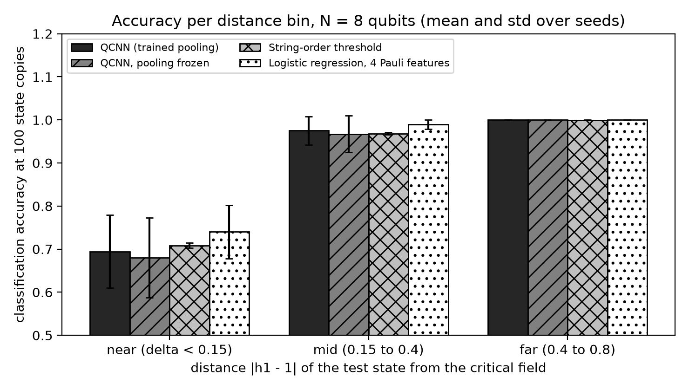
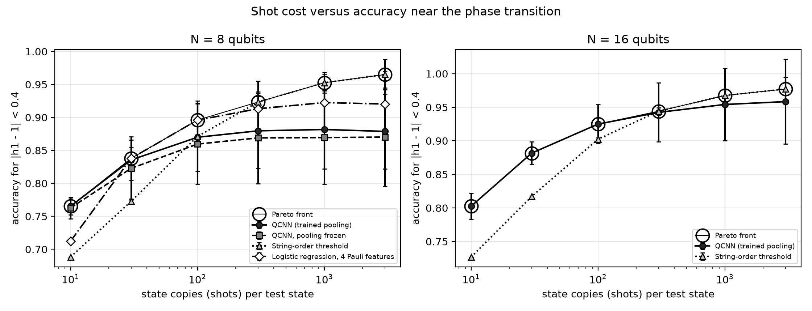
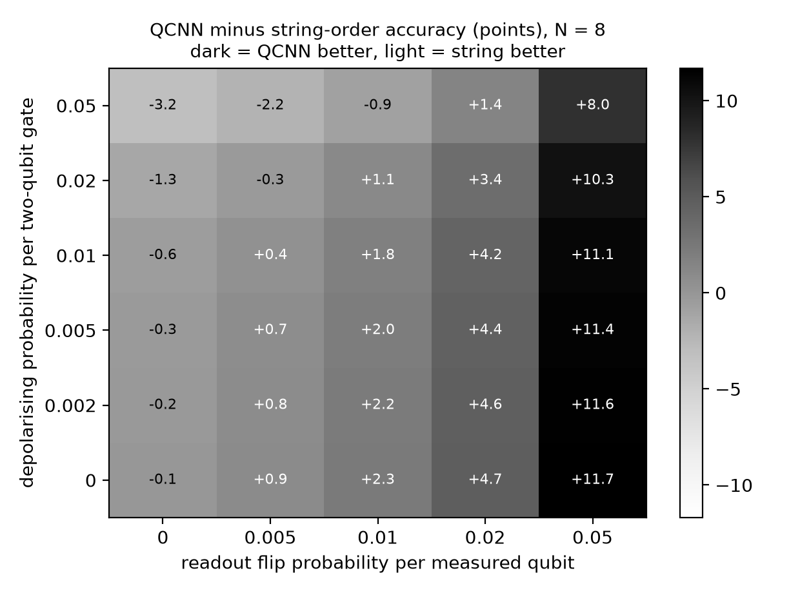
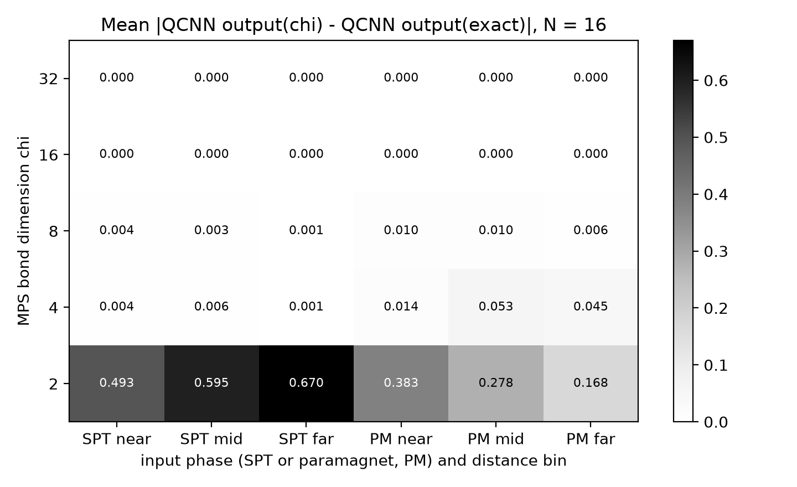
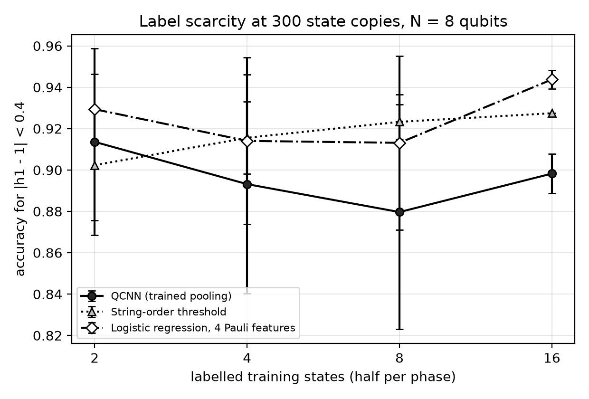

# How many state copies does a quantum convolutional neural network need near a topological phase transition?

[](LICENSE)
[](pyproject.toml)
[](https://github.com/pradeepdegalaroyal/qcnn-vs-string-order-spt-shot-budget/actions/workflows/ci.yml)

**Abstract.** A Quantum Convolutional Neural Network (QCNN) recognises the symmetry-protected-topological (SPT)
phase of a cluster-Ising chain with only O(log N) parameters, but the literature does not charge it for the number of
state copies (shots), for gate and readout noise, or compare it with a classical estimator that reads the same copies.
This exact-simulation study (8 and 16 qubits, 3 to 5 seeds) puts a trained QCNN, the cluster-state string order and a
trained four-feature Pauli classifier on one ledger and adds a Matrix Product State (MPS) probe of how much entanglement a
classical simulation of the QCNN input must keep. The QCNN wins when copies are scarce (16 qubits, 10 copies:
0.802 vs 0.727) but saturates below the string order (16 qubits, 3000 copies: 0.958 vs 0.977), and two of my three
pre-stated hypotheses are falsified as written.

## Motivation

Quantum machine learning on quantum data is attractive because the data never has to be read out in full. Whether
that pays off depends on a cost ledger that is rarely written down: copies of the state per decision, noise per
gate, noise per measured qubit, and what a classical tensor-network method would need on the same task. Near a phase
transition the signal is smallest, so the ledger is tightest exactly where recognition is hardest.

## Research gap

Cong, Choi and Lukin (2019, doi:10.1038/s41567-019-0648-8) introduced the QCNN and report that it surpasses existing
approaches for SPT recognition. Orús (2019, doi:10.1038/s42254-019-0086-7) reviews tensor networks, the classical
tool for the same phases, whose cost is set by entanglement. Gyongyosi and Imre (2019, doi:10.1016/j.cosrev.2018.11.002)
list noise and readout among the open problems of near-term hardware, and Cvitić and Gavrilović (2027,
doi:10.1007/978-3-032-40818-1_7) show in a simulation study that detector efficiency, i.e. the readout, dominates
the usable rate of a quantum network. Nothing in the supplied literature compares these on one ledger. The full
related-work table (12 papers, three roles) and the three falsifiable hypotheses are in
[`docs/RESEARCH_GAP.md`](docs/RESEARCH_GAP.md). Most of the supplied papers concern materials and devices, so only
three of them bear directly on the question.

Hypotheses (stated before the runs): **H1** the QCNN needs fewer copies than both baselines to reach 90% accuracy near the transition;
**H2** its advantage shrinks with gate error and grows with readout error; **H3** the Matrix Product State bond dimension (chi)
needed to reproduce its readout grows towards the critical point.

## What is new here

* A copy-matched (shot-matched) comparison of a trained QCNN with a one-setting string estimator and a trained multi-setting
  Pauli classifier, resolved by distance from the critical field.
* A joint gate-noise by readout-noise grid that locates where the QCNN's single-qubit readout compensates for its
  circuit depth.
* A bond-dimension probe: how large an MPS must the input be for a classical contraction to reproduce the QCNN readout.
* Compiled controlled-NOT (CX) counts of the trained circuits on a line, to translate logical-gate error into hardware error.

## Method in brief

Periodic chain H = - sum Z X Z - h1 sum X; the SPT phase is h1 < 1, the paramagnet (PM) h1 > 1. Eight labelled states with
|h1 - 1| >= 0.3 train every method; the test states (32, disjoint) go down to |h1 - 1| = 0.025. Full design in
[`docs/METHOD.md`](docs/METHOD.md).

```mermaid
%%{init: {'theme': 'base', 'themeVariables': {'primaryColor': '#ffffff', 'primaryTextColor': '#000000', 'primaryBorderColor': '#000000', 'lineColor': '#000000', 'secondaryColor': '#ffffff', 'tertiaryColor': '#ffffff', 'background': '#ffffff', 'noteBkgColor': '#ffffff', 'noteTextColor': '#000000', 'actorBkg': '#ffffff', 'actorBorder': '#000000', 'actorTextColor': '#000000', 'signalColor': '#000000', 'signalTextColor': '#000000', 'labelBoxBkgColor': '#ffffff', 'labelTextColor': '#000000', 'clusterBkg': '#ffffff', 'clusterBorder': '#000000'}}}%%
classDiagram
    class Hamiltonian["hamiltonian.py: exact ground states"] {
        +ground_state()
        +string_order()
        +load_states()
    }
    class QCNN["qcnn.py: Quantum Convolutional Neural Network"] {
        +conv parameters 15 per layer
        +pool parameters 4 per layer
        +forward()
        +noisy_forward()
        +to_qiskit()
    }
    class Trainer["train.py: Adam on mean-square error"] {
        +train_qcnn()
        +transfer_init()
    }
    class Baselines["baselines.py: Pauli feature classifier"] {
        +LocalFeatureTables
        +LocalFeatureClassifier
    }
    class Shots["shots.py: exact binomial accuracy"] {
        +prob_correct()
        +midpoint_threshold()
    }
    class MPS["mps.py: Matrix Product State truncation"] {
        +truncate_state()
        +half_chain_entropy()
    }
    class Studies["studies.py: four studies"] {
        +main_study()
        +noise_grid()
        +mps_study()
        +compiled_cost()
    }
    class Results["results/ csv and json files"] {
        +e1 to e4 tables
        +summary.json
    }
    class Plots["plots.py: five greyscale figures"] {
        +summarise()
    }
    Hamiltonian --> Studies
    QCNN --> Trainer
    Trainer --> Studies
    Baselines --> Studies
    Shots --> Studies
    MPS --> Studies
    Studies --> Results
    Results --> Plots
```

Legend: QCNN = Quantum Convolutional Neural Network; MPS = Matrix Product State; csv = comma-separated values;
json = JavaScript Object Notation.

* **Methods:** `qcnn` (57 parameters at 8 qubits, 76 at 16), `qcnn-no-pool` (45 parameters; pooling frozen, the ablation),
  `string` (string-order threshold), `local-LR` (logistic regression on four Pauli features, 8 qubits only).
* **Cost model:** `S` state copies per test state. QCNN and string give one plus-or-minus-one outcome per copy; the
  feature classifier splits `S` over three measurement settings. Accuracy is the exact binomial success probability.
* **Noise:** depolarising probability `p2` after each logical two-qubit gate (density-matrix simulation) and a flip
  probability `r` on every measured qubit; thresholds are re-fitted under the same noise.

## Results: three claims

Everything below is read from [`results/`](results/) (`e1_accuracy.csv`, `e2_noise_grid.csv`, `e3_mps_truncation.csv`,
`e4_compiled_cost.csv`, `summary.json`). "Critical region" is |h1 - 1| < 0.4. Mean plus or minus standard deviation over
seeds (5 at 8 qubits, 3 at 16 qubits).

### Claim 1. The QCNN is the cheapest classifier with very few copies, but it saturates lower, so my shot-efficiency hypothesis (H1) fails as stated

Accuracy in the critical region (training set: 8 labelled states):

| Qubits | Method | 10 copies | 30 | 100 | 300 | 1000 | 3000 |
|---|---|---|---|---|---|---|---|
| 8 | QCNN | 0.765 ± 0.013 | 0.835 ± 0.030 | 0.870 ± 0.052 | 0.880 ± 0.057 | 0.882 ± 0.060 | 0.879 ± 0.057 |
| 8 | QCNN, pooling frozen | 0.763 ± 0.016 | 0.823 ± 0.048 | 0.860 ± 0.061 | 0.869 ± 0.070 | 0.869 ± 0.071 | 0.870 ± 0.074 |
| 8 | String-order threshold | 0.688 ± 0.000 | 0.773 ± 0.004 | 0.871 ± 0.003 | 0.923 ± 0.008 | 0.953 ± 0.016 | 0.965 ± 0.023 |
| 8 | Logistic regression, 4 features | 0.712 ± 0.003 | 0.838 ± 0.017 | 0.896 ± 0.029 | 0.913 ± 0.042 | 0.922 ± 0.042 | 0.920 ± 0.049 |
| 16 | QCNN | 0.802 ± 0.019 | 0.882 ± 0.017 | 0.925 ± 0.029 | 0.942 ± 0.044 | 0.954 ± 0.054 | 0.958 ± 0.063 |
| 16 | String-order threshold | 0.727 ± 0.000 | 0.817 ± 0.001 | 0.902 ± 0.002 | 0.944 ± 0.005 | 0.968 ± 0.009 | 0.977 ± 0.017 |



*Takeaway: far from the transition every method is at 1.0; the differences live in the near and mid bins, and the near bin (|h1 - 1| < 0.15) is hard for all of them at 8 qubits.*



*Takeaway: at 16 qubits the Pareto front is the QCNN up to 100 copies and the string estimator from 300 copies; at 8 qubits it is the QCNN at 10 copies, the feature classifier at 30 to 100 copies and the string estimator from 300.*

* The QCNN's separation from its threshold is larger: mean distance from threshold in the critical region 0.292 (QCNN) vs 0.142
  (string) at 16 qubits, 0.266 vs 0.114 at 8 qubits (`summary.json`, `margin_crit_region`). That explains the low-copy advantage.
* Shots to 90% critical-region accuracy (S*, grid 10 to 3000): 8 qubits, QCNN never (none of the grid), string 300, feature classifier 300;
  16 qubits, QCNN 100 and string 100 (a tie). H1 required the QCNN to beat both, so **H1 is falsified**.
* **Caveats.** Seed spread of the QCNN (0.05 to 0.06) is larger than most gaps; the 16-qubit network is initialised from the 8-qubit solution and
  fine-tuned for 40 steps on 3 seeds; training ends at a mean-square error between 0.12 and 0.27 (`summary.json`, `train_loss`),
  so the QCNN plateau may be an optimisation limit rather than a capacity limit. The test labels use the infinite-chain rule h1 < 1, which a small chain only approximates.

### Claim 2. The QCNN's single-qubit readout buys robustness to measurement error, and gate noise takes it back (H2 supported)



*Takeaway: accuracy gain of the QCNN over the string estimator rises with readout error (+11.7 ± 4.8 points at r = 0.05, no gate noise) and falls with gate error (-3.2 ± 3.7 points at p2 = 0.05, r = 0).*

* Without noise the two are level (-0.1 ± 5.0 points). The string order touches 5 of 8 qubits, so its signal is multiplied by (1 - 2r)^5 against (1 - 2r) for the QCNN.
* Break-even at r = 0.01 lies between p2 = 0.02 (+1.1 ± 4.2) and p2 = 0.05 (-0.9). The 8-qubit circuit has 18 logical two-qubit gates that compile to 62 CX gates on a line (47 all-to-all); the 16-qubit circuit has 41 logical gates
  and 180 (108) CX gates (`e4_compiled_cost.csv`). On a line at 8 qubits, p2 = 0.01 therefore corresponds to roughly 0.3% per CX (0.01 / 3.4 CX per logical gate; a derived estimate).
* **Caveats.** Seed spread is 3 to 5 points, so only the r = 0.05 column is clearly beyond noise; the QCNN is trained without noise
  (noise-aware training could move the break-even); one noise model; 8 qubits only (density matrices).

### Claim 3. An open-chain MPS of bond dimension 4 reproduces the QCNN readout; H3 (more entanglement near criticality) is not supported



*Takeaway: bond dimension 2 destroys the readout (mean error 0.17 to 0.67), bond dimension 4 already gives error at or below 0.053 in every cell and the same infinite-copy accuracy as the exact input.*

* At 16 qubits, chi = 4 reaches infinite-copy accuracy 0.979, equal to the exact input (`summary.json`, `mps`); chi = 2 gives 0.531. The mean error at chi = 4 is
  0.030 in the mid bin and 0.023 in the far bin against 0.009 in the near bin (`summary.json`), so the near bin is not harder and H3 is falsified for this probe.
* **Caveats.** Only 16 qubits and a single model per seed; a periodic state cut open needs roughly the square of its periodic bond dimension, and at this size
  the critical entanglement growth is hardly resolved; this does not say a 100-qubit QCNN input is cheap to simulate.

### Further evidence: label scarcity and the pooling ablation



*Takeaway: more labels do not help the QCNN here (0.914 ± 0.045 with 2 labels, 0.898 ± 0.009 with 16 at 300 copies), while the feature classifier improves to 0.944 ± 0.004.*

* **Ablation:** freezing the pooling gates changes critical-region accuracy at 100 copies from 0.870 ± 0.052 to 0.860 ± 0.061, i.e. no measurable
  difference at 8 qubits; trained pooling costs 12 more parameters.

## Discussion

The honest summary is mixed. The QCNN is a useful low-copy classifier, probably because it builds a larger decision margin than the raw
string order, and it is more tolerant to readout error. It is not the best classifier once copies are plentiful: a single-setting string estimate beats
it at 8 qubits (0.965 ± 0.023 vs 0.879 ± 0.057 at 3000 copies), and a trained four-feature classifier beats it at 8 qubits at 100 copies and above.
That the physics-informed string order is strong is no surprise, and the QCNN's O(log N) parameter count did not translate into fewer labels.
Two of three hypotheses fail as written (H1, H3); H2 holds in sign but with seed noise of 3 to 5 points. Nothing here is a claim of quantum advantage.

## Limitations

* Exact simulation of 8 and 16 qubits only; one Hamiltonian slice (the XX term is zero), one noise family, noise-free state preparation.
* QCNN trained with a mean-square loss and 2 restarts; better optimisation might lift the plateau. N = 16 uses 3 seeds.
* The feature classifier is run at 8 qubits only and sees exact features during training.
* The 90% threshold and the critical-region bin are choices made before looking at the 16-qubit data but after a one-seed check at 8 qubits.

## Future work

* Noise-aware QCNN training and a hardware-native ansatz so that p2 maps one-to-one to a measured CX error (the transpiled counts here are the starting point).
* Classical shadows for the feature classifier, and a larger chain through MPS-based circuit simulation, to see whether the low-copy advantage survives at 32 to 64 qubits.
* A tensor-network-initialised QCNN, and the XX-coupled phase boundary where no exact critical point is known.
* On a real device: run the 8-qubit QCNN with randomised compiling and report the same copy-by-accuracy curve.

## Reproducibility

```bash
pip install -r requirements.txt
pytest -q                               # 9 tests, about 20 seconds
python experiments/run_all.py --quick   # smoke run, about 35 seconds, writes results_quick/ and figures_quick/
python experiments/run_all.py           # full run, writes results/ and figures/
```

Full run: about 10 minutes (the first run adds about 105 seconds to compute and cache the 16-qubit ground states in `data/raw/`; the run logged 566 s with a warm cache).
Hardware: Windows 11, 16 threads, torch limited to 6 threads, central processing unit only (the graphics card is not used), Python 3.11.9, pinned versions in `requirements.txt`.
Continuous integration (`.github/workflows/ci.yml`) installs CPU dependencies, runs `pytest` and the quick run on ubuntu-latest.

## Project structure

```
src/spt_shotbench/   hamiltonian.py qcnn.py train.py baselines.py shots.py mps.py studies.py plots.py
experiments/run_all.py
tests/test_core.py
docs/RESEARCH_GAP.md docs/METHOD.md
results/             e1_accuracy.csv e1_test_outputs.csv e2_noise_grid.csv e3_mps_truncation.csv e4_compiled_cost.csv summary.json
figures/             fig1 to fig5 (200 dpi, greyscale)
```

## Related work by the author

* [QML-TensorNet-ManyBody](https://github.com/pradeepdegalaroyal/QML-TensorNet-ManyBody): tensor-network models for many-body problems.
* [anytime-valid-shot-stopping-quantum-circuit-tests](https://github.com/pradeepdegalaroyal/anytime-valid-shot-stopping-quantum-circuit-tests): shot-budget thinking for circuit tests, which this study applies to a learned classifier.

## Citation

```bibtex
@software{degala_qcnn_string_order_shot_budget_2026,
  author  = {Degala Chenchupradeep},
  title   = {Shot-Budget Benchmark of a Quantum Convolutional Neural Network against String-Order and Tensor-Network Baselines for Phase Recognition},
  year    = {2026},
  version = {0.1.0},
  url     = {https://github.com/pradeepdegalaroyal/qcnn-vs-string-order-spt-shot-budget},
  license = {MIT}
}
```

MIT license (`LICENSE`). Citation metadata is also in `CITATION.cff`.
